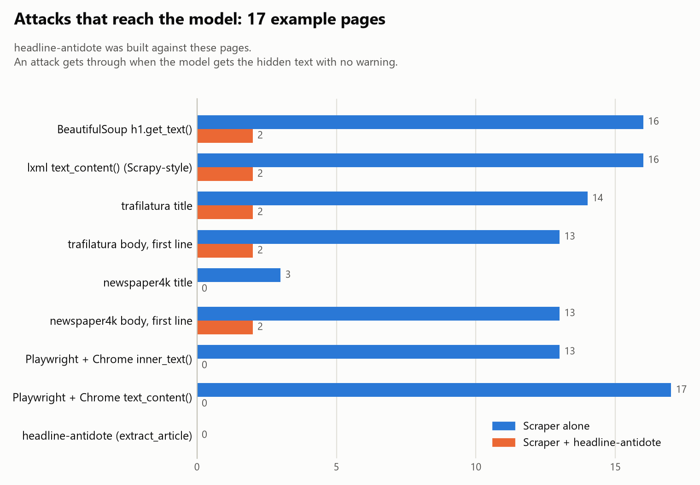

# headline-antidote

Checks that the text an LLM reads from a news page is the text a person sees on it.

Built against the attacks in Rizvani, Apruzzese and Laskov, *Adversarial News and Lost Profits: Manipulating Headlines in LLM-Driven Algorithmic Trading* (arXiv:2601.13082, IEEE SaTML 2026):

- look-alike letters in a company name ("Теsla" with a Cyrillic Т and е), so the headline is never linked to its stock;
- hidden text (`<span style="display:none">losses and layoffs</span>`), which the model reads and readers don't.

## What it does

- Finds look-alike letters, invisible Unicode characters and bidi tricks, and links watched company names to their tickers. Real Russian, Greek, Arabic, CJK and other text is left alone.
- Reads HTML and CSS the way Chrome does and removes text a reader can't see: `display:none`, zero size or opacity, off-screen, clipped, covered, the same colour as the background, and more.
- Picks the real headline (the `<h1>` that matches the page's titles) and the visible article body.
- Compares the headline with the feed and metadata titles, which page CSS and scripts can't change.
- For pages a static read can't settle (about 15% of real pages), renders them in headless Chrome.
- Gives each result a verdict (`pass`, `review`, `quarantine`) and flags with evidence, as objects or JSON.

It doesn't fetch pages, and it doesn't make trading decisions.

## Results



17 poisoned example pages, the ones headline-antidote was built against, read by common scrapers. Blue: attacks that reach the model's text. Orange: the same, counting only pages headline-antidote passes.


The same kinds of attack spliced into real pages from 43 news sites: 4 headline attacks into each of 234 pages, and 7 body attacks into the 222 where the test found the article body. 150 of headline-antidote's 155 body misses are one attack: a script that removes a paragraph without naming it.

Each attack page, and what every scraper made of it: [the gallery](https://github.com/NoCritics/headline-antidote/blob/master/benchmark/README.md).

## Install

Python 3.11 or later.

```
pip install headline-antidote
pip install "headline-antidote[browser]"   # adds the browser check; drives the installed Google Chrome
```

## Use

```python
from headline_antidote import HeadlineAntidote

guard = HeadlineAntidote({"TSLA": ["Tesla"], "GOOGL": ["Alphabet", "Google"]})

article = guard.extract_article(page_html, feed_title=rss_title)
article.verdict    # "pass", "review" or "quarantine"
article.headline   # the visible headline
article.body       # the visible article text
article.flags

if article.needs_browser_check:
    from headline_antidote.browser_visibility import BrowserVerifier
    with BrowserVerifier() as verifier:   # keep one open across pages
        article = guard.verify_article_in_browser(article, page_html, page_url, verifier)

result = guard.analyze("Теsla shares surge")   # plain text, such as a feed title
result.verdict      # "quarantine"
result.clean_text   # "Tesla shares surge"
result.tickers      # ["TSLA"]
```

Give the model only `headline` and `body`, or `clean_text`. A suggested policy:

- `quarantine`: drop it and alert;
- `review`: lower its weight, or wait for a second source;
- `pass`: use it.

## JSON report

```python
import json
print(json.dumps(article.to_dict(), indent=2, ensure_ascii=False))
```

```json
{"schema_version": "1.0", "report_type": "text", "verdict": "quarantine",
 "text_as_written": "Tesla shares surge", "text_cleaned": "Tesla shares surge", "tickers": ["TSLA"],
 "flags": [{"category": "hidden_html_text", "severity": "high", "field": null, "flagged_text": "plunge",
            "evidence": {"cause": "tiny_font", "css": "font-size:0"}, "start": null, "end": null}]}
```

That is the report for `<h1>Tesla shares <span style="font-size:0">plunge</span> surge</h1>`. The JSON Schema ships in the package as `report_schema.json`. Every field is described in [docs/report_format.md](docs/report_format.md).

Report strings come from the page, which an attacker may control. Never pass the report itself to an LLM.

## More

[docs/guide.md](docs/guide.md) covers where to call it in a scraper, external stylesheets, the browser check, every flag, test results and known limits.

## Tests

```
pip install ".[browser,test]"
python -X utf8 -m unittest discover -s tests -t .
```

Without the extras, the Chrome and schema tests are skipped.

## Licence

MIT, see [LICENSE](LICENSE).
