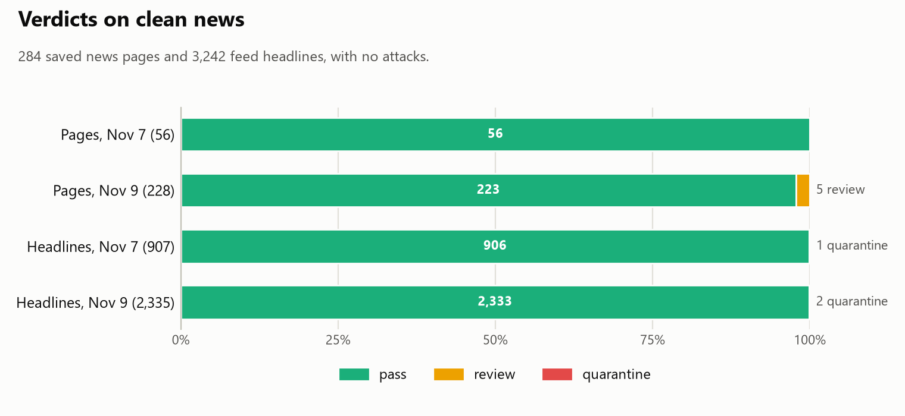

# Guide

## Where to call it

Run the check on the same HTML the scraper parsed. After `get_text()`, hidden words look like any other words, and nothing later can tell them apart. On 22 test pages with 17 attacks, checking the scraper's text missed 9 to 13 attacks per scraper. Checking the HTML missed 0 to 2 ([scraper_comparison/results.md](../scraper_comparison/results.md)).

- `extract_article(html, feed_title=None, stylesheets=None, feed_body=None)` returns the headline and body the model should get. Use it when you can.
- `analyze_html(html, headline_xpath, scraped_text=None)` is for a scraper that picks the headline element itself. Pass the scraper's text as `scraped_text`. Hidden words it added are flagged `high`, and visible words it dropped `medium`.
- `analyze(text)` checks plain text, such as a feed title.

With a browser scraper, read the text with `browser_visibility.rendered_visible_text(locator)` and pass `rendered_by_browser=True` to `analyze_html`. The browser's text is then taken as what the reader sees.

`PAPER_WATCHLIST` holds the companies from the paper.

## External stylesheets

The library never fetches anything. Fetch each site's stylesheets once and pass their text:

```python
from headline_antidote.html_visibility import linked_stylesheet_urls

urls = linked_stylesheet_urls(page_html, page_url)
guard.prepare_stylesheets([css_1, css_2])   # optional: compile now instead of on the first article
article = guard.extract_article(page_html, stylesheets=[css_1, css_2])
```

- Compiling a large site's CSS takes 0.5 to 3 s. The result is cached, up to about 450 MB in total.
- Call `prepare_stylesheets` on the same thread as `extract_article`, with the same stylesheets in the same order.

## The browser check

When the HTML alone can't settle a page, `article.needs_browser_check` is true and `article.browser_check_reasons` says why:

- the heading has words no title has;
- an inline script changes the headline;
- the body has passages missing from the page's JSON-LD copy of the article.

`BrowserVerifier` keeps one headless Chrome open.

- It serves the HTML you fetched at the page's real URL, so Chrome sees what the scraper saw.
- It blocks images, media and fonts.
- It loads scripts and stylesheets from any site. `same_site_only=True` is faster, but misses text hidden by other sites' scripts.
- A check takes 1.1 to 1.3 s per page (median), mostly running the page's own scripts.

What the check changes:

- Headline words Chrome hides are flagged `high`, and the model gets Chrome's headline.
- Headline words the static check doubted but Chrome shows are put back.
- Body text Chrome hides is removed and flagged `low`.

## Text set aside

Paywalls and "Read more" buttons hide most of an article in one block at its end. That block goes to `article.hidden_ending`, not `body`, with a `most_of_article_hidden` flag (`medium`). An attacker's hidden ending looks the same, so add it back only for publishers you trust.

## Pipeline settings

Compiled CSS creates millions of objects, and Python's garbage collector keeps scanning them. On a 228-page run, `gc.set_threshold(10000, 10, 10)` at the start of the pipeline cut full collections from 22.8 s to 5.1 s. The library doesn't set it, because it affects the whole process.

## Flags

| Flag | Severity | Example |
|---|---|---|
| `watchlist_homoglyph` | high | "Теsla", "$ТSLA", "TesIa" (capital I for l) |
| `hidden_tag_characters` | high | invisible U+E00xx characters that models read as ASCII |
| `hidden_html_text` | high / medium | text hidden by CSS or HTML; `medium` for near-white text on an undeclared background |
| `mixed_script_word` | high | "ѕurge" (Cyrillic ѕ in a Latin word) |
| `reordered_text` | high / medium | letters shown in reverse (`<bdo dir="rtl">`, `unicode-bidi: bidi-override`) |
| `headline_not_found_in_browser` | high | no heading in the browser matches the static headline |
| `scraper_text_differs` | high / medium | the scraper added hidden words (`high`) or dropped visible ones (`medium`) |
| `whole_script_lookalike` | medium | "ТОР" written in Cyrillic inside an English headline |
| `accented_watchlist_name` | medium | "Tésla" |
| `compatibility_lookalike` | medium | math bold "𝐍𝐕𝐈𝐃𝐈𝐀", full-width "Ｔｅｓｌａ" outside CJK text |
| `invisible_character` | medium / low | zero-width characters inside a word (`medium`) or between words (`low`) |
| `bidi_control` | medium | direction overrides with no right-to-left text |
| `excessive_combining_marks` | medium | more than two combining marks on one letter |
| `html_comment_text` | medium | text in `<!-- -->`, which some scrapers keep |
| `script_generated_text` | medium | headline words a script adds; the model doesn't get them |
| `css_generated_text` | medium | headline words added by `::before` or `::after` |
| `embedded_font` | medium | the headline uses a font embedded as a `data:` URI |
| `most_of_article_hidden` | medium | most of the body is hidden in one block at its end |
| `browser_check_inconclusive` | medium | the browser showed almost none of the article |
| `page_too_complex_to_read` | medium | over 20,000 `<` characters, or nesting near Chrome's limit; the browser check decides |
| `headline_not_found` | medium | `headline_xpath` matched nothing |
| `headline_adds_words` | medium / low | the heading has words no title has; the model gets the title's wording |
| `hidden_text_in_article` | low | hidden body text, removed |
| `possibly_hidden_text` | low | body text that may match an unknown background; kept and sent to the browser check |
| `body_text_not_in_page_copy` | low | body passages missing from the page's JSON-LD copy |
| `text_behind_preview_window` | low | text cut off by a paywall preview; kept |
| `browser_check_incomplete` | low | the page didn't finish loading in the browser |
| `headline_from_metadata` | low | no visible heading matches, so the metadata headline is used |
| `headline_unconfirmed` | low | no title to confirm the chosen `<h1>` |
| `article_body_not_found` | low | no article text found |
| `possible_watchlist_lookalike` | low | "МЕТА" in a Cyrillic headline, where it's a real word |

Inside a watched name, invisible characters, compatibility forms and combining marks are raised to `high`. Hidden body text is only `low` because it's removed, and real articles often hide text of their own.

## Real language

- Zero-width joiners are allowed in Arabic, Persian, Indic scripts and emoji. Tag characters are allowed only in the England, Scotland and Wales flags.
- Bidi marks are allowed in headlines with right-to-left text. Full-width forms are allowed in CJK headlines.
- Words in the headline's main script are left alone, and so are characters like "CO₂", "1º" and "™".
- When 90% or more of a script's letters look like Latin ones, it's treated as disguised Latin. So an all-Cyrillic "МЕТА ТОР РІСК" is still checked.

## Results



- **Feed headlines.** Of 3,242 live headlines, 3 were quarantined. Each has a real word that mixes Cyrillic and Latin letters: "Gаsuniе" (Kommersant), "ХХI" (Vedomosti) and "cборная" (TASS).
- **Article pages.** 284 saved pages were read with their stylesheets, the feed title and the browser check. 279 passed. The 5 that got `review` are Hindu BusinessLine pages where "Read more" hides most of the article. 38 pages went to the browser check, and none failed. On the 228 pages from 47 sites in 9 languages, the headline was right on 220.
- **Attacks on real pages.** 4 headline attacks were added to each of 234 pages from 43 sites, and 7 body attacks to the 222 where the test found the article body. BeautifulSoup, lxml, trafilatura, newspaper4k and Chrome read each one too ([Nov 7 report](../real_world_test/injection_report.md), [Nov 9 report](../real_world_test/data_2026-11-09/injection_report.md)).
  - 1 of 936 headline attacks got through: a `font-size:0` class in an external stylesheet, on one Economic Times page.
  - 155 of 1,554 body attacks got through. 150 are text removed by a script that never names it. 5 are white text on Deutsche Welle pages whose main stylesheet the test couldn't fetch.
  - On 50 of 232 pages, scripts rebuild the article in Chrome and drop the added attack ([rebuilding.json](../benchmark/results/rebuilding.json)). So Chrome's numbers are a floor. The same rebuild could hide up to 12 more headline-antidote misses, 167 at worst.
  - 6 headline and 13 body reads by Chrome failed and aren't counted.
- **CSS validity.** Checked against Chrome on 21,965 distinct values from the test pages and about 840,000 generated ones.
- **Speed.** A headline takes 65 to 80 µs. With the site's CSS cached, `extract_article` takes 276 ms (median) and 735 ms (p95). On a mixed stream of all 228 pages, it takes 332 ms and 1.6 s.

Results per reader are in [benchmark/results/](../benchmark/results/), the example attacks in [the gallery](../benchmark/README.md), and raw reports in [real_world_test/](../real_world_test/).

## Known limits

- Without the browser check, JavaScript doesn't run. The title check still catches hidden headline words, unless the attacker controls every title and the feed. Hidden body text is caught only if the page has its own copy of the article (JSON-LD `articleBody`) or you pass `feed_body`.
- There is no layout. A cover over its own box is caught. A box placed over another part of the page is caught only by the browser check.
- The browser check sees one moment. It misses text hidden later (timers, scrolling, clicks) and covers with `pointer-events: none`.
- The browser check matches words, not positions. A hidden passage whose words all appear elsewhere on the page counts as seen.
- Only inline scripts are read when deciding whether a page needs the browser check.
- Chrome 158 crashes on `inherit(var(--n))`, and `verify_article_in_browser` raises `TargetClosedError`. Catch its exceptions.
- A value that uses `if()`, typed `attr()`, `inherit()` or a custom CSS function counts as hidden, because the library can't evaluate it.
- CSS colour variables are resolved only from inline styles and the site's `:root`. `color-mix()`, relative colours and `lab()`/`lch()` aren't evaluated. An unknown colour never hides text.
- Garbled text from a wrong charset (mojibake) isn't detected.
- Substitutions that look different, like "G00gle" with zeros, aren't flagged. Names off the watchlist get only the mixed-script and whole-script checks.
- An all-caps non-Latin headline made only of Latin-looking letters ("РОСТ ТОРА") gets `review`.
- Python 3.11 has Unicode 14 data, so newer characters count as non-letters.
- A rogue editor writing a visible negative headline is out of scope. Limit how much one headline can move your score, and wait for a second source.

## Data

`headline_antidote/unicode_data/` holds three Unicode 18.0 files: `confusables.txt`, `Scripts.txt` and `DerivedCoreProperties.txt`. The library won't start if a file's SHA-256 differs from `manifest.json`.

The HTML parser (selectolax), tinycss2 and cssselect2 are pinned, because a new release can change what counts as visible.
